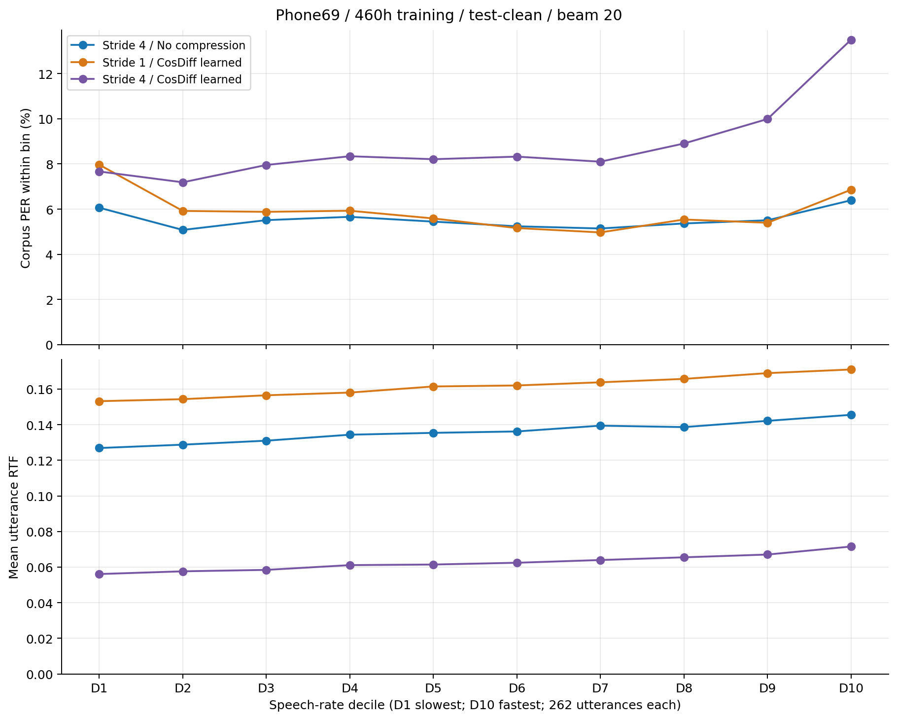
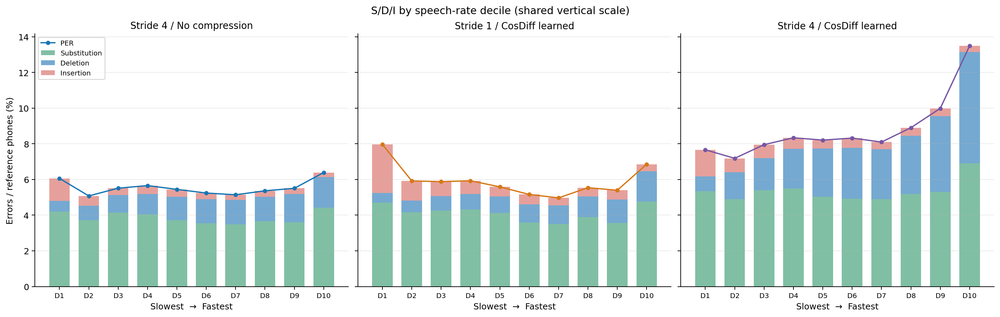
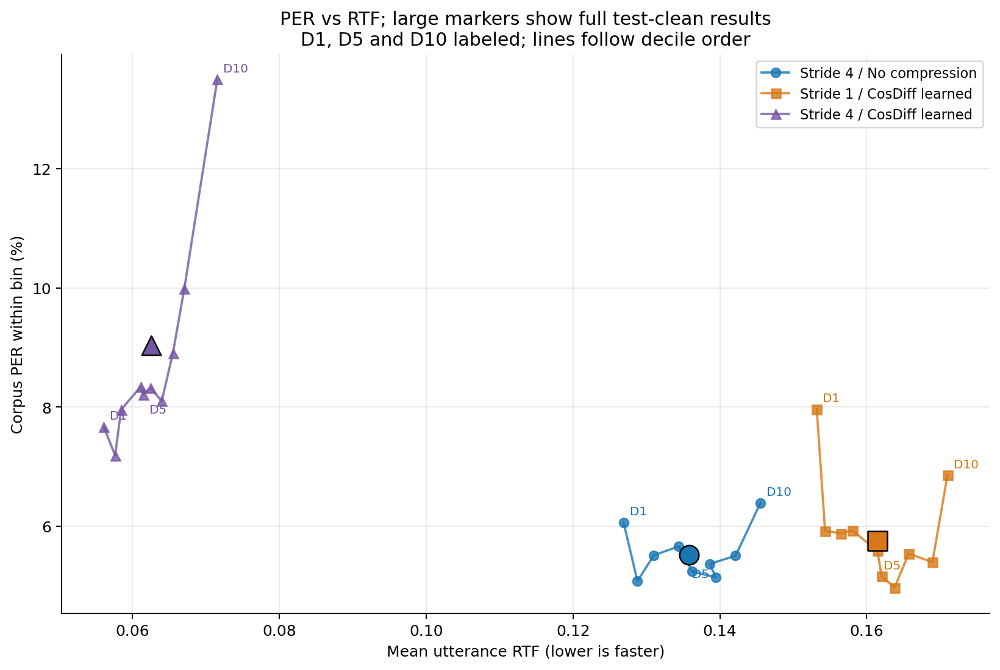

# 460h 三组模型：十档语速评测报告

> 历史实验说明（2026-10-18）：本目录统计对应已作废的旧三组 `exp_phone69_460h_<方案>_s42_e50`（动态组使用旧 keep_rate/上下文定义），保留用于复核历史结果；不代表当前 `offline_native` 四组自然峰谷重训结果，相关旧 checkpoint 已按用户要求删除。语速分档清单仍可复用于相同 test-clean。

训练：train-clean-100 + train-clean-360（共 460h），三组均完成 50 轮；测试：同一份 test-clean，共 2620 句、189023 个参考音素。每组使用训练记录中的最佳 checkpoint，固定 phone69、beam=20、A100 80 GiB。

本报告按 Emformer 原始十档 ID 清单，重新执行分档、逐句编辑对齐核验和汇总。识别结果与计时来自已通过校验的完整 test-clean 单调时钟评测，未另行运行模型推理。解码器每句独立创建，分档不改变识别结果。

## 统计口径与 Emformer 脚本的对应

- 分档不变：PPM=源音素数/FLAC 音频时长×60，D1 最慢、D10 最快，每档 262 句；同速边界沿用原顺序。
- 保留原脚本的总编辑数/总参考数汇总方法；本项目使用完整、保留大小写和重音的 phone69，指标命名为 PER。未沿用旧脚本的小写化、去空格和 SentencePiece 切分。
- S/D/I 为最小编辑对齐中的替换/删除/插入；比率均除以该档参考音素数。并列路径优先 match、substitution、deletion、insertion；旧脚本优先 substitution、insertion、deletion，重复音素处的分类可能不同。
- RTF 使用 time.perf_counter() 复测值，报告逐句 RTF 的算术平均，保留 evaluator 的特征帧时长分母与推理计时范围。原 Emformer 汇总 RTF 按音频时长加权，不能直接与本表比较。旧墙钟计时的无效 RTF 未使用。
- 这是按语速分组的描述性结果；各档说话人、内容和时长也不同，不能把差异单独归因为语速。

## 全测试集结果

| 模型 | PER | 平均逐句 RTF | 替换 S（比率） | 删除 D（比率） | 插入 I（比率） |
| --- | ---: | ---: | ---: | ---: | ---: |
| stride4_none | 5.5173% | 0.13584 | 7210 (3.8144%) | 2473 (1.3083%) | 746 (0.3947%) |
| stride1_cosd_learned | 5.7559% | 0.16150 | 7593 (4.0170%) | 2024 (1.0708%) | 1263 (0.6682%) |
| stride4_cosd_learned | 9.0328% | 0.06251 | 10116 (5.3517%) | 5920 (3.1319%) | 1038 (0.5491%) |

## 主要观察

- stride4_none 的全量 PER 最低（5.5173%）。stride1_cosd_learned 为 5.7559%，本次结果没有带来整体准确率或平均逐句 RTF 优势。
- stride4_cosd_learned 的平均逐句 RTF 为 0.06251，按本次 RTF 比值约为 baseline 的 2.17 倍推理速度，但全量 PER 上升至 9.0328%。
- stride4_cosd_learned 在最快档 D10 的 PER 为 13.4973%，最慢档 D1 为 7.6662%；其中删除率从 0.8344% 升至 6.2514%。最快档的删除错误值得进一步分析。







## 十档范围

| 档位 | PPM 范围（音素/分钟） | 均值 PPM | 句数 | 参考音素数 |
| --- | ---: | ---: | ---: | ---: |
| decile_01 | 96.26–423.59 | 353.78 | 262 | 7670 |
| decile_02 | 423.87–486.82 | 459.58 | 262 | 13427 |
| decile_03 | 487.13–526.25 | 506.81 | 262 | 15527 |
| decile_04 | 526.27–556.52 | 541.97 | 262 | 18164 |
| decile_05 | 556.59–582.29 | 569.90 | 262 | 19221 |
| decile_06 | 582.32–606.77 | 595.35 | 262 | 21734 |
| decile_07 | 607.00–632.56 | 619.21 | 262 | 24088 |
| decile_08 | 632.65–659.21 | 645.62 | 262 | 23461 |
| decile_09 | 659.63–704.29 | 679.40 | 262 | 23608 |
| decile_10 | 704.38–887.89 | 749.20 | 262 | 22123 |

## stride4_none 分档明细

| 档位 | PER | 平均逐句 RTF | S（比率） | D（比率） | I（比率） | 错误总数/参考数 |
| --- | ---: | ---: | ---: | ---: | ---: | ---: |
| decile_01 | 6.0626% | 0.12688 | 322 (4.1982%) | 47 (0.6128%) | 96 (1.2516%) | 465/7670 |
| decile_02 | 5.0793% | 0.12877 | 499 (3.7164%) | 110 (0.8192%) | 73 (0.5437%) | 682/13427 |
| decile_03 | 5.5130% | 0.13101 | 644 (4.1476%) | 153 (0.9854%) | 59 (0.3800%) | 856/15527 |
| decile_04 | 5.6595% | 0.13436 | 734 (4.0410%) | 207 (1.1396%) | 87 (0.4790%) | 1028/18164 |
| decile_05 | 5.4472% | 0.13540 | 714 (3.7147%) | 253 (1.3163%) | 80 (0.4162%) | 1047/19221 |
| decile_06 | 5.2406% | 0.13619 | 770 (3.5428%) | 294 (1.3527%) | 75 (0.3451%) | 1139/21734 |
| decile_07 | 5.1436% | 0.13944 | 842 (3.4955%) | 328 (1.3617%) | 69 (0.2864%) | 1239/24088 |
| decile_08 | 5.3664% | 0.13863 | 860 (3.6657%) | 320 (1.3640%) | 79 (0.3367%) | 1259/23461 |
| decile_09 | 5.5066% | 0.14215 | 850 (3.6005%) | 377 (1.5969%) | 73 (0.3092%) | 1300/23608 |
| decile_10 | 6.3915% | 0.14553 | 975 (4.4072%) | 384 (1.7358%) | 55 (0.2486%) | 1414/22123 |

## stride1_cosd_learned 分档明细

| 档位 | PER | 平均逐句 RTF | S（比率） | D（比率） | I（比率） | 错误总数/参考数 |
| --- | ---: | ---: | ---: | ---: | ---: | ---: |
| decile_01 | 7.9661% | 0.15319 | 361 (4.7066%) | 41 (0.5346%) | 209 (2.7249%) | 611/7670 |
| decile_02 | 5.9209% | 0.15433 | 560 (4.1707%) | 86 (0.6405%) | 149 (1.1097%) | 795/13427 |
| decile_03 | 5.8801% | 0.15651 | 661 (4.2571%) | 128 (0.8244%) | 124 (0.7986%) | 913/15527 |
| decile_04 | 5.9293% | 0.15803 | 784 (4.3162%) | 160 (0.8809%) | 133 (0.7322%) | 1077/18164 |
| decile_05 | 5.5876% | 0.16146 | 792 (4.1205%) | 178 (0.9261%) | 104 (0.5411%) | 1074/19221 |
| decile_06 | 5.1624% | 0.16202 | 777 (3.5750%) | 224 (1.0306%) | 121 (0.5567%) | 1122/21734 |
| decile_07 | 4.9693% | 0.16380 | 847 (3.5163%) | 250 (1.0379%) | 100 (0.4151%) | 1197/24088 |
| decile_08 | 5.5411% | 0.16571 | 915 (3.9001%) | 272 (1.1594%) | 113 (0.4817%) | 1300/23461 |
| decile_09 | 5.3965% | 0.16895 | 842 (3.5666%) | 309 (1.3089%) | 123 (0.5210%) | 1274/23608 |
| decile_10 | 6.8571% | 0.17100 | 1054 (4.7643%) | 376 (1.6996%) | 87 (0.3933%) | 1517/22123 |

## stride4_cosd_learned 分档明细

| 档位 | PER | 平均逐句 RTF | S（比率） | D（比率） | I（比率） | 错误总数/参考数 |
| --- | ---: | ---: | ---: | ---: | ---: | ---: |
| decile_01 | 7.6662% | 0.05609 | 410 (5.3455%) | 64 (0.8344%) | 114 (1.4863%) | 588/7670 |
| decile_02 | 7.1870% | 0.05762 | 657 (4.8931%) | 204 (1.5193%) | 104 (0.7746%) | 965/13427 |
| decile_03 | 7.9539% | 0.05843 | 839 (5.4035%) | 278 (1.7904%) | 118 (0.7600%) | 1235/15527 |
| decile_04 | 8.3407% | 0.06110 | 999 (5.4999%) | 402 (2.2132%) | 114 (0.6276%) | 1515/18164 |
| decile_05 | 8.2098% | 0.06144 | 967 (5.0310%) | 521 (2.7106%) | 90 (0.4682%) | 1578/19221 |
| decile_06 | 8.3234% | 0.06243 | 1068 (4.9140%) | 623 (2.8665%) | 118 (0.5429%) | 1809/21734 |
| decile_07 | 8.0995% | 0.06396 | 1182 (4.9070%) | 674 (2.7981%) | 95 (0.3944%) | 1951/24088 |
| decile_08 | 8.9041% | 0.06549 | 1218 (5.1916%) | 764 (3.2565%) | 107 (0.4561%) | 2089/23461 |
| decile_09 | 9.9881% | 0.06705 | 1250 (5.2948%) | 1007 (4.2655%) | 101 (0.4278%) | 2358/23608 |
| decile_10 | 13.4973% | 0.07154 | 1526 (6.8978%) | 1383 (6.2514%) | 77 (0.3481%) | 2986/22123 |

## 来源与复现

- 参考脚本：本地 emformer_rnnt_copy/eval_fast_slow.py、exp/experiments/plot_decile_errors.py；仅参考分档与报告组织方式，以上口径差异已明确。
- [三组十档 CSV](../all_models_deciles.csv)、[完整分档汇总 JSON](../summary.json)、各模型目录下的 details/decile_XX_details.csv。
- [本次独立核验记录](validation_report.json)：7860 条逐句参考、预测、S/D/I 最小编辑对齐、RTF 和源 CSV 一致；十档无重复无遗漏；训练记录与最佳 checkpoint 一致。
- 图表同时提供 PNG 与矢量 PDF，位于 figures/。

```sh
python scripts/diagnostics/report_speech_rate_deciles.py --results eval_deciles_460h_作废_旧方法 --out eval_deciles_460h_作废_旧方法/report_new
```

各组 checkpoint：

- stride4_none: `/test21/conformer-rnnt-asr/exp_phone69_460h_stride4_none_s42_e50/checkpoints/val-none-epoch=49-step=60426.ckpt`
- stride1_cosd_learned: `/test21/conformer-rnnt-asr/exp_phone69_460h_stride1_cosd_learned_s42_e50/checkpoints/val-none-epoch=41-step=50538.ckpt`
- stride4_cosd_learned: `/test21/conformer-rnnt-asr/exp_phone69_460h_stride4_cosd_learned_s42_e50/checkpoints/val-none-epoch=46-step=40084.ckpt`
