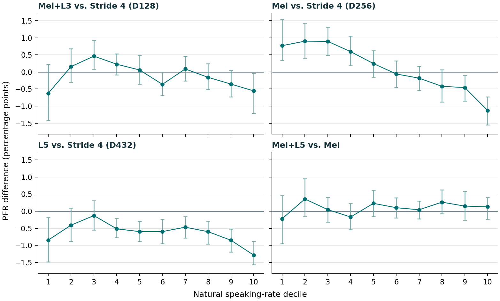

# 460 小时实验的自然语速十档分析

2026-11-22。分析覆盖 21 个主配置和 4 个补充检查点或复跑。基于冻结的 2,620 句 test-clean 预测和实际 beam 20 主要 MAC 计数，每个系统使用相同的十档和参考。每档有 262 句，按原始录音每分钟参考音素数（PPM）从慢到快排序，时长包含停顿。PER 以档内总参考音素数为分母，算量以档内总音频秒为分母。Mel+L2 使用训练中的第 31 轮快照。

## 对照结果

- **L5 对 Stride 4 D432，十档都更准。** 两组 30 秒编码器与融合预算接近（21.380 对 21.538 GMAC），实际总算量在每档低 **14.1%–22.2%**。整体 PER 为 4.781% 对 5.426%，差 **−0.645** 个百分点。逐档差为 −1.288 到 −0.129 个百分点，D10 的差最大。D2 和 D3 的区间跨零。两组主干宽度不同，此对照衡量所训练系统的近预算表现。
- **同为宽度 128，Mel+L3 对 Stride 4 在快端表现较好。** 十档算量均低 **13.5%–15.1%**，PER 在五档较低，包含 D8–D10。D10 为 7.142% 对 7.698%，差 −0.556 个百分点。D1 同样较低，单用两端的差中之差为 +0.070 个百分点，区间跨零。整体差 −0.108 个百分点，区间跨零。将第二次融合放在 L5 的系统比 D128 在八档更准，整体差 −0.441 个百分点且实际算量在十档低 3.8%–7.9%。按固定 30 秒编码器与融合口径，Mel+L5 为 5.268 GMAC，D128 为 4.336 GMAC。
- **Mel 对 D256 的交叉最清楚。** D1–D5 的 PER 高 **0.245–0.901** 个百分点，D6–D10 低 **0.060–1.130** 个百分点。整体差只有 −0.021 个百分点。Mel 在十档的实际总算量低 6.5%–12.9%。这是两个不同主干宽度的系统在不同自然语速档里的交叉。
- **Mel+L5 对 Mel 的第二阶段代价在各档都有限。** 实际总算量逐档再少 **38.4%–39.6%**，逐档 PER 差在 **−0.222 到 +0.357** 个百分点之间，各档区间都跨零。整体差 +0.110 个百分点。Mel+L3 相对 Mel+L5 再少 7.6%–10.7% 的档内实际算量，九档 PER 点估计较高。
- **极低预算的代价在快端更明显。** Stride 4+L2 在十档的算量都是最低，D1 至 D10 由 0.1130 增至 0.1463 GMAC／音频秒，PER 由 6.532% 增至 9.922%。三阶段 Mel+L5+L8 的 D10 PER 为 8.548%，Mel+L2 的阶段性结果为 9.063%。L5 整体 PER 最低，同时在主配置中取得 D1、D7、D8、D9 的最低点估计。逐档名次随配置和检查点而变。

四组主要对照的差值与 95% 区间如下。零线上方表示前一个系统的 PER 较高。

## 其余配置的表现

- **固定步长。** 固定每帧投影为 128 维的 Stride 2 相比 Stride 1 在八档 PER 更低，十档的实际总算量都更低，降幅为 10.7%–18.4%。Stride 8 的 D10 PER 为 10.030%。这些配置的堆叠宽度随步长改变，应作为完整系统对照。
- **单阶段位置。** L7 只在 D6 和 D10 的点估计比 L5 低，分别低 0.101 和 0.023 个百分点，十档的算量均较高。L9 在十档的 PER 和算量都高于 L5。L1、L2 提供了更低算量的位置选择。L3 的原验证检查点与独立复跑在十档均比 L2 误差高，差值分别为 0.638–1.434 和 0.531–1.233 个百分点。改用第 31 轮后，有三档的点估计低于 L2。这表明早先看到的 L3 劣化分布在多个语速档，并对检查点敏感。
- **多阶段位置。** Mel+L7 相对 Mel+L5 的实际算量在每档高 9.1%–10.3%，四档的 PER 点估计更低。Mel+L2 的阶段性模型相对 Mel+L3 每档再省 6.0%–8.3%，PER 每档均增加 0.248–1.921 个百分点。这个比较针对已评快照。

## 如何解读两端

25 份结果里，16 份的最低 PER 出现在 D7，最高 PER 全部出现在 D1 或 D10（10 份与 15 份）。D1 和 D10 同为 262 句，但参考音素分别为 7,670 和 22,123，平均句长分别为 4.81 和 6.78 秒，仅 22 位说话人在两档都有录音。PER 的同档模型比较固定了句子和参考。跨档变化同时反映发音、停顿、句长、内容和说话人构成。同句变速实验才可在这些因素更受控的条件下检验速度效应。

在 D1、D10 都有录音的 22 位说话人中，Mel 对 D256 的 PER 差仍由 **+1.106** 变为 **−0.827** 个百分点（143 句对 141 句）。先限制原录音长度在 3–9 秒，再取两端都有录音的 15 人，差值由 **+2.296** 变为 **−0.805**（63 句对 86 句）。同样的两步限制下，L5 对 D432 在两端仍都较低，分别低 **0.918** 和 **0.872** 个百分点。Mel 对 D256 的方向交叉在这些子集里复现，L5 对 D432 的收益在两端更接近。子集比较采用相同的档内汇总口径，样本更少且句子内容仍不同。

D512 的慢端对检查点特别敏感。第 10、31、47 轮在 D1 的 PER 依次为 **7.588%、12.920%、21.121%**，插入错误数依次为 **213、697、1,284**。其中一条参考仅 3 个音素的录音，第 31、47 轮分别输出 59 和 50 个音素。合并 D2–D10 后，L5 仍比 D512 第 31 轮低 0.587 个百分点。D432 的预算与 L5 更接近，其 D1 PER 为 6.258%。

在 D10 同一批 22,123 个参考音素上，Stride 8、Stride 4+L2、D432 和 L5 的删除错误数依次是 **1,111、951、519、261**。前两组的高 PER 伴随更多漏识别。L5 相对 D432 少 86 个替换、258 个删除，多 59 个插入，净少 285 个错误。Mel 相对 D256 的快端改善也主要来自删除错误减少 361 个，同时替换和插入分别增加 10 和 101 个。以上使用最小编辑距离对齐，替换、删除和插入的代价均为 1。回溯遇到同代价路径时，依次优先匹配、替换、删除、插入。

高语速档的单位时间解码算量也会变。例如 L5 从 D1 到 D10，编码器与融合由 0.3890 到 0.4005 GMAC／音频秒，predictor 与 joiner 合计由 0.1703 到 0.2136。总算量的变化主要来自实际搜索。在对照压缩器时，应分别查看编码器与融合成本以及含搜索的全系统成本。

## 配对不确定性

对 40 位说话人联合有放回重抽 10,000 次（seed 42），每次保留抽中说话人的全部语速档记录，按总音素数重新计算两模型的 PER 差。每个对照使用同一批抽样比较十档，以及原来的慢组 D1–D3、快组 D8–D10。下表负值有利于前一个模型，快减慢是两组模型差的差值。区间为点态 95% 百分位区间，用于描述固定检查点在这些录音上的抽样变化，未做多重比较校正。快减慢的结果适合写成自然语速组的关联，优势随人为变速的变化仍需独立验证。

| 对照 | 整体差，百分点［95% 区间］ | 快组差减慢组差，百分点［95% 区间］ |
| --- | ---: | ---: |
| Mel+L3 − D128 | −0.108［−0.241, +0.034］ | −0.476［−0.934, −0.074］ |
| Mel+L5 − D128 | −0.441［−0.586, −0.303］ | −0.483［−0.926, −0.025］ |
| Mel − D256 | −0.021［−0.209, +0.174］ | −1.531［−1.921, −1.122］ |
| L5 − D432 | −0.645［−0.796, −0.499］ | −0.524［−0.947, −0.154］ |
| Mel+L5 − Mel | +0.110［−0.011, +0.232］ | +0.077［−0.263, +0.406］ |
| Mel+L3 − Mel+L5 | +0.332［+0.209, +0.452］ | +0.008［−0.423, +0.369］ |

[六组对照逐档区间 CSV](paired_deciles.csv) · [全部逐档 PER 与 MAC 分项 CSV](groups.csv) · [逐句归档和检查点清单](manifest.json) · [固定 30 秒 D432 计数](../../evaluations/phone69_stride4_dim432_local_cpu_20261122/REPORT.md)

## 十档 PER（%）

| 配置或检查点 | D1 | D2 | D3 | D4 | D5 | D6 | D7 | D8 | D9 | D10 |
| --- | ---: | ---: | ---: | ---: | ---: | ---: | ---: | ---: | ---: | ---: |
| Stride 4 / D128 | 8.123 | 5.645 | 5.680 | 5.918 | 5.749 | 5.811 | 5.438 | 6.023 | 6.155 | 7.698 |
| Stride 4 / D256 | 5.828 | 4.618 | 4.862 | 5.357 | 5.187 | 5.241 | 5.169 | 5.818 | 5.824 | 7.540 |
| Stride 4 / D432 | 6.258 | 4.938 | 5.049 | 5.505 | 5.432 | 5.080 | 4.720 | 5.302 | 5.380 | 6.916 |
| Stride 4 / D512，第 31 轮 | 12.920 | 4.268 | 4.605 | 4.927 | 4.838 | 4.923 | 4.890 | 5.652 | 5.685 | 7.490 |
| Stride 1 / D128 | 5.724 | 5.064 | 4.946 | 5.214 | 4.906 | 4.776 | 4.500 | 4.838 | 4.668 | 5.822 |
| Stride 2 / D256 | 7.392 | 4.893 | 4.734 | 4.872 | 4.750 | 4.712 | 4.280 | 4.744 | 4.685 | 5.555 |
| Stride 8 / D1024 | 5.854 | 4.953 | 5.693 | 5.836 | 6.358 | 6.069 | 6.028 | 6.760 | 7.489 | 10.030 |
| Mel | 6.597 | 5.519 | 5.758 | 5.951 | 5.432 | 5.181 | 4.986 | 5.396 | 5.367 | 6.410 |
| L1 | 6.232 | 4.848 | 5.036 | 5.588 | 5.374 | 5.093 | 5.081 | 5.396 | 5.519 | 6.541 |
| L2 | 6.128 | 5.102 | 5.629 | 5.687 | 5.640 | 4.992 | 4.886 | 5.520 | 5.443 | 6.486 |
| L3，第 31 轮 | 5.802 | 5.236 | 5.449 | 6.017 | 5.551 | 5.264 | 5.372 | 5.639 | 5.608 | 7.259 |
| L5 | 5.411 | 4.528 | 4.920 | 4.988 | 4.833 | 4.481 | 4.251 | 4.701 | 4.528 | 5.628 |
| L7 | 5.502 | 4.729 | 5.120 | 5.021 | 5.036 | 4.380 | 4.351 | 4.791 | 4.621 | 5.605 |
| L9 | 5.711 | 4.811 | 4.978 | 5.070 | 5.047 | 4.573 | 4.442 | 4.740 | 4.727 | 5.704 |
| Mel+L2（阶段性检查点） | 7.744 | 6.256 | 6.943 | 6.997 | 6.899 | 6.653 | 6.576 | 7.148 | 7.569 | 9.063 |
| Mel+L3 | 7.497 | 5.802 | 6.144 | 6.144 | 5.806 | 5.448 | 5.526 | 5.865 | 5.799 | 7.142 |
| Mel+L5 | 6.375 | 5.876 | 5.803 | 5.781 | 5.660 | 5.282 | 5.027 | 5.660 | 5.515 | 6.536 |
| Mel+L7 | 6.415 | 5.459 | 5.738 | 5.748 | 5.806 | 5.356 | 5.301 | 5.533 | 5.930 | 6.789 |
| Mel+L5+L8 | 6.962 | 6.770 | 7.033 | 7.207 | 6.883 | 6.589 | 6.501 | 6.926 | 7.061 | 8.548 |
| Stride 2 + L2 / D128 | 9.648 | 6.643 | 6.730 | 6.805 | 6.410 | 6.101 | 5.995 | 6.466 | 6.438 | 7.856 |
| Stride 4 + L2 / D128 | 6.532 | 6.718 | 6.704 | 7.570 | 7.440 | 7.145 | 7.037 | 7.758 | 7.917 | 9.922 |
| Stride 4 / D512，第 10 轮 | 7.588 | 5.258 | 5.655 | 5.803 | 5.510 | 5.199 | 5.007 | 5.558 | 5.600 | 7.296 |
| Stride 4 / D512，第 47 轮 | 21.121 | 4.290 | 4.495 | 4.663 | 4.922 | 4.739 | 4.591 | 5.430 | 5.706 | 7.951 |
| L3，验证最优第 15 轮 | 7.562 | 5.988 | 6.267 | 6.529 | 6.352 | 5.917 | 5.775 | 6.300 | 6.379 | 7.508 |
| L3，从头复跑第 15 轮 | 6.728 | 5.980 | 6.402 | 6.238 | 6.170 | 6.225 | 5.600 | 6.172 | 6.180 | 7.553 |

## 十档实际总 GMAC／音频秒

| 配置或检查点 | D1 | D2 | D3 | D4 | D5 | D6 | D7 | D8 | D9 | D10 |
| --- | ---: | ---: | ---: | ---: | ---: | ---: | ---: | ---: | ---: | ---: |
| Stride 4 / D128 | 0.2272 | 0.2377 | 0.2387 | 0.2414 | 0.2449 | 0.2453 | 0.2478 | 0.2480 | 0.2502 | 0.2511 |
| Stride 4 / D256 | 0.3973 | 0.4078 | 0.4071 | 0.4119 | 0.4153 | 0.4150 | 0.4201 | 0.4183 | 0.4205 | 0.4190 |
| Stride 4 / D432 | 0.7192 | 0.7392 | 0.7361 | 0.7424 | 0.7454 | 0.7456 | 0.7525 | 0.7496 | 0.7502 | 0.7453 |
| Stride 4 / D512，第 31 轮 | 0.9275 | 0.9311 | 0.9248 | 0.9312 | 0.9336 | 0.9326 | 0.9395 | 0.9353 | 0.9355 | 0.9280 |
| Stride 1 / D128 | 0.9065 | 1.0228 | 1.0074 | 1.0389 | 1.0490 | 1.0504 | 1.0798 | 1.0652 | 1.0632 | 1.0307 |
| Stride 2 / D256 | 0.8092 | 0.8536 | 0.8450 | 0.8593 | 0.8667 | 0.8654 | 0.8812 | 0.8741 | 0.8736 | 0.8574 |
| Stride 8 / D1024 | 1.2953 | 1.3077 | 1.3063 | 1.3103 | 1.3123 | 1.3122 | 1.3170 | 1.3164 | 1.3172 | 1.3173 |
| Mel | 0.3461 | 0.3770 | 0.3732 | 0.3810 | 0.3824 | 0.3836 | 0.3901 | 0.3895 | 0.3897 | 0.3920 |
| L1 | 0.4008 | 0.4307 | 0.4266 | 0.4339 | 0.4370 | 0.4375 | 0.4435 | 0.4419 | 0.4419 | 0.4369 |
| L2 | 0.4420 | 0.4833 | 0.4768 | 0.4867 | 0.4898 | 0.4901 | 0.4998 | 0.4948 | 0.4939 | 0.4849 |
| L3，第 31 轮 | 0.4779 | 0.5275 | 0.5191 | 0.5319 | 0.5348 | 0.5348 | 0.5465 | 0.5410 | 0.5383 | 0.5246 |
| L5 | 0.5592 | 0.6240 | 0.6119 | 0.6281 | 0.6324 | 0.6298 | 0.6461 | 0.6386 | 0.6343 | 0.6141 |
| L7 | 0.6215 | 0.7050 | 0.6891 | 0.7089 | 0.7140 | 0.7109 | 0.7307 | 0.7182 | 0.7118 | 0.6856 |
| L9 | 0.6896 | 0.7912 | 0.7722 | 0.7944 | 0.7996 | 0.7979 | 0.8215 | 0.8065 | 0.7984 | 0.7635 |
| Mel+L2（阶段性检查点） | 0.1777 | 0.1878 | 0.1886 | 0.1919 | 0.1936 | 0.1944 | 0.1974 | 0.1991 | 0.2003 | 0.2041 |
| Mel+L3 | 0.1933 | 0.2046 | 0.2031 | 0.2066 | 0.2081 | 0.2090 | 0.2116 | 0.2128 | 0.2142 | 0.2172 |
| Mel+L5 | 0.2091 | 0.2276 | 0.2258 | 0.2312 | 0.2326 | 0.2332 | 0.2369 | 0.2376 | 0.2394 | 0.2414 |
| Mel+L7 | 0.2287 | 0.2511 | 0.2490 | 0.2542 | 0.2550 | 0.2565 | 0.2607 | 0.2615 | 0.2612 | 0.2637 |
| Mel+L5+L8 | 0.1711 | 0.1888 | 0.1891 | 0.1942 | 0.1954 | 0.1972 | 0.2006 | 0.2023 | 0.2030 | 0.2063 |
| Stride 2 + L2 / D128 | 0.2108 | 0.2260 | 0.2275 | 0.2318 | 0.2348 | 0.2361 | 0.2393 | 0.2419 | 0.2441 | 0.2458 |
| Stride 4 + L2 / D128 | 0.1130 | 0.1228 | 0.1260 | 0.1297 | 0.1327 | 0.1344 | 0.1366 | 0.1381 | 0.1410 | 0.1463 |
| Stride 4 / D512，第 10 轮 | 0.9029 | 0.9245 | 0.9196 | 0.9259 | 0.9296 | 0.9286 | 0.9363 | 0.9325 | 0.9322 | 0.9251 |
| Stride 4 / D512，第 47 轮 | 0.9389 | 0.9332 | 0.9249 | 0.9302 | 0.9335 | 0.9319 | 0.9387 | 0.9345 | 0.9341 | 0.9258 |
| L3，验证最优第 15 轮 | 0.4795 | 0.5279 | 0.5185 | 0.5309 | 0.5350 | 0.5325 | 0.5443 | 0.5381 | 0.5359 | 0.5208 |
| L3，从头复跑第 15 轮 | 0.4788 | 0.5284 | 0.5204 | 0.5317 | 0.5352 | 0.5348 | 0.5456 | 0.5400 | 0.5381 | 0.5245 |

## 语速档的样本构成

| 档位 | PPM 范围 | PPM 中位数 | 说话人 | 参考音素 | 平均句长（秒） | 最低 PER 配置 |
| --- | ---: | ---: | ---: | ---: | ---: | ---: |
| D1 | 96.26–423.59 | 370.11 | 32 | 7,670 | 4.81 | L5（5.411%） |
| D2 | 423.87–486.82 | 460.11 | 35 | 13,427 | 6.69 | Stride 4 / D512，第 31 轮（4.268%） |
| D3 | 487.13–526.25 | 505.67 | 37 | 15,527 | 7.02 | Stride 4 / D512，第 31 轮（4.605%） |
| D4 | 526.27–556.52 | 542.57 | 39 | 18,164 | 7.67 | Stride 2 / D256（4.872%） |
| D5 | 556.59–582.29 | 570.02 | 37 | 19,221 | 7.73 | Stride 2 / D256（4.750%） |
| D6 | 582.32–606.77 | 596.43 | 37 | 21,734 | 8.36 | L7（4.380%） |
| D7 | 607.00–632.56 | 619.29 | 35 | 24,088 | 8.91 | L5（4.251%） |
| D8 | 632.65–659.21 | 645.75 | 35 | 23,461 | 8.33 | L5（4.701%） |
| D9 | 659.63–704.29 | 677.83 | 35 | 23,608 | 7.96 | L5（4.528%） |
| D10 | 704.38–887.89 | 739.66 | 29 | 22,123 | 6.78 | Stride 2 / D256（5.555%） |

## 主要对照的十档 PER 差（百分点）

| 对照 | D1 | D2 | D3 | D4 | D5 | D6 | D7 | D8 | D9 | D10 |
| --- | ---: | ---: | ---: | ---: | ---: | ---: | ---: | ---: | ---: | ---: |
| Mel+L3 − D128 | -0.626 | +0.156 | +0.464 | +0.226 | +0.057 | -0.363 | +0.087 | -0.158 | -0.356 | -0.556 |
| Mel+L5 − D128 | -1.747 | +0.231 | +0.122 | -0.138 | -0.088 | -0.529 | -0.411 | -0.362 | -0.640 | -1.162 |
| Mel − D256 | +0.769 | +0.901 | +0.895 | +0.595 | +0.245 | -0.060 | -0.183 | -0.422 | -0.457 | -1.130 |
| L5 − D432 | -0.847 | -0.410 | -0.129 | -0.518 | -0.598 | -0.598 | -0.469 | -0.601 | -0.851 | -1.288 |
| Mel+L5 − Mel | -0.222 | +0.357 | +0.045 | -0.171 | +0.229 | +0.101 | +0.042 | +0.264 | +0.148 | +0.127 |
| Mel+L3 − Mel+L5 | +1.121 | -0.074 | +0.341 | +0.363 | +0.146 | +0.166 | +0.498 | +0.205 | +0.284 | +0.606 |
