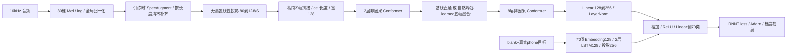

# Phone69 460h 四组：完整运算逻辑与逐项审批审计

审计日期：2026-10-18。范围为当前 `offline_native` 四组，包含数据、增强、张量长度、主干、选帧、融合、预测器、损失、优化器、验证与恢复。报告不是只搜索 keep_rate/context 字符串。

**更新：用户已单独批准 A05，三组动态配置改为 five_frames 并从头重训，已训练完成的基线保留。其它编号继续 pending，没有应用相应建议。最新计算和启动记录见 [five_frames 报告](phone69_460h_five_frames_computation_20261018.md)。以下表格及复现数据保留原始 diff5 审计快照，不能当作新三组当前运行参数。**

审计使用服务器实际 PyTorch / torchaudio `2.6.0+cu124`，在独立 CPU 进程重新构建 `LibriSpeechRNNTModule.from_config`，没有附加调试器修改训练进程。服务器自身 UTC：运行时审计 `2026-10-18T02:06:09+00:00`，边界复现 `02:13:02+00:00`。代码提交 `ade7e14` 的主干和四份 YAML 与启动门槛 SHA-256 全部一致；该提交仅新增历史分速材料。

证据：[实际对象/前向/反向](../artifacts/runs/phone69_460h_native_offline_20261018/runtime_audit_20261018.json)、[边界反例](../artifacts/runs/phone69_460h_native_offline_20261018/runtime_audit_edge_cases_20261018.json)、[依赖实现与统计量](../artifacts/runs/phone69_460h_native_offline_20261018/runtime_audit_details_20261018.json)、[52 项回归测试](../artifacts/runs/phone69_460h_native_offline_20261018/runtime_audit_tests_20261018.log)。

## 一、审批清单

各编号独立审批。A01–A03 有可复现的计算/数值问题；A04–A08 是必须明确的方法或训练协议选择；A09–A14 是验证/保存策略、来源证据和实现定义。未批准前全部保持现状。

| 编号 | 发现 | 建议与批准后的动作 | 对当前实验的影响 |
|---|---|---|---|
| A01 | 有效编码结果依赖批内 padding 长度，eval 模式也能复现 | 修正 Conformer 内卷积/归一化对 padding 的处理，先验证独句与拼批的有效区一致性；不能只在输入处清零 | 改变主干计算，建议四组统一从头重训 |
| A02 | 边界融合先 softmax 后屏蔽，有限极端 logits 可产生 0/0→NaN | 对越界位置先屏蔽 logits，再在合法位置 softmax | 数学上保持原权重定义、修复浮点失稳；可验证兼容续训，若与 A01/A03 合并则统一重训 |
| A03 | SpecAugment 整批共享遮罩，时间比例按补齐后的最大长度计算 | 每句在真实长度内独立增强，再补齐；只设置 iid_masks=True 不足以解决比例问题 | 改变训练分布，建议四组统一重训 |
| A04 | 峰取 t+1、谷取 t，二者可映射到同一帧再去重 | 先确认此定位就是方法定义；若要峰谷统一同一侧定位，另立版本和实验 | 改定义需重训；保留现定义不需改动 |
| A05 | diff5 权重输入是 L1 变化量的相邻绝对差，最多涉及六帧，不是五个原始帧或余弦距离 | 确认继续使用该四维输入，或另定义五帧特征/四个一阶差分 | 改融合输入需重训 |
| A06 | 短序列/常量序列无峰谷时只退回候选 0，不强制保留末帧 | 确认该兜底；也可选择短句直通，但应明确适用长度 | 改兜底会改变压缩定义，需新版本实验 |
| A07 | 反向优化使用句损失之和，日志才除以句数 | 确认 sum 协议；若改 mean，需要连同 LR/梯度裁剪解释一起定案 | 改目标缩放需统一重训，不能单组随意调整 |
| A08 | 同为 50 epoch，但批次预算不同导致更新数、warmup 所占轮数不同 | 明确“同维度、同数据轮数”的公平性；若要等优化步/等计算量对照，单列新实验 | 新训练协议需重新安排，不能悄悄修改运行队列 |
| A09 | 最佳模型按 dev RNNT loss 选择，不是 PER | 确认按loss选模，或批准另行制定PER选模方案 | 改选模会改变最终checkpoint；独立评测需另行授权 |
| A10 | 每200批验证，不保证最终epoch尾部再验证 | 确认现频率，或批准补充轮末验证 | 不直接改梯度，但改变选模机会和验证开销 |
| A11 | top-2 会淘汰旧候选，last.ckpt 可能停留在旧步；完整边界另行保存 | 确认采用 top-2 + 每轮不可变完整边界，或批准保存所有验证快照 | 保存策略变更不必改模型；现有安全恢复应继续以合格边界为依据 |
| A12 | 外部global_stats只有mean/invstddev，没有生成数据集与脚本信息 | 补齐统计量来源审计后确认继续沿用，或批准仅训练集重新估计 | 来源不足不能直接称为泄漏；换统计量需统一重训 |
| A13 | Conformer未额外加入显式位置编码，依赖卷积/拼帧提供时序结构 | 确认保留此主干，或另立带位置编码的对照 | 属共享结构选择，改变需四组统一重训 |
| A14 | 自定义LSTM将归一化后的cell状态传入下一步 | 确认此LayerNorm-LSTM变体，或另立保留原始cell状态的对照 | 改预测器会影响所有组，需统一重训 |

审批记录保存在 [audit_approval_state.json](../artifacts/runs/phone69_460h_native_offline_20261018/audit_approval_state.json)，初始全部 pending。后续用户批准某一编号，只授权该编号的具体方案；不自动授权其它编号。

## 二、四组实际配置与张量主线

| 顺序 | 配置方案 | 输入投影 | 拼帧 S | 主干宽 | 后块长度 | phone-token 预算 | 总参数 |
|---|---|---:|---:|---:|---|---:|---:|
| 1 | stride4_none | 80→32 | 4 | 128 | n=ceil(T/4) | 23500 | 4,207,942 |
| 2 | stride1_cosd_learned | 80→128 | 1 | 128 | K₁(x) | 6500 | 4,215,947 |
| 3 | stride2_cosd_learned | 80→64 | 2 | 128 | K₂(x) | 16000 | 4,210,827 |
| 4 | stride4_cosd_learned | 80→32 | 4 | 128 | K₄(x) | 32600 | 4,208,267 |

四份配置均为 `configs/server_phone69_460h_offline_native_<方案>_s42_e50.yaml`。两块合计参数均为 3,846,400；动态融合网络各 325 参数。公平的是主干宽度、2+8 层、8 头、FFN512、预测器和输出256，不是总参数、优化步或实际 FLOPs 完全相同。

## 三、数据、标签、特征和增强

- 数据严格为 train-clean-100 + train-clean-360；dev-clean 用于训练内验证。test-clean 只作为未来评测配置保留，当前 `fit` 不调用 test。两个训练子集各自分批，再 ConcatDataset；不把不同子集的句子合进同一批。
- phone69 为 69 个带重音 ARPABET，blank=69，总输出70。按空格分割完整 phone，保留大小写/重音，过滤 spn，不走 SentencePiece、IPA 发音部位目标或其它辅助损失。
- 16kHz，FFT/window 400（25ms），hop160（10ms），80 Mel，默认功率谱；torchaudio STFT 默认 Hann 窗、center=True、反射补齐。这里的声学窗与动态融合中的历史 hanning 名字是两回事。
- 长度 T 包含正常的中心化 STFT 边界帧；N=16000 个采样的合成输入实测 T=101，N=12800 实测 T=81。不是增加了特殊左右上下文。
- `piecewise_linear_log`：先乘 G=32767²，若 Gx>e 则取 ln(Gx)，否则取 Gx/e；之后 `(x-mean)*invstddev`。实际 Mel 由模块 `_mel_kwargs` 创建，hop160；`common.py` 的全局 hop80 变换没有进入当前训练特征路径。
- 外部统计文件 `/test21/librispeech/global_stats.json` 有80维 mean/invstddev，文件 SHA-256 为 `022a496264bafdba8ecb65f72d71a579c76f6f8c56e41866a600272fc3b1c457`；生成语料范围尚无元数据，不能据此断言完全只用460h，亦不能断言包含测试集。 与仓库 `assets/statistics/global_stats.json` 的规范化JSON哈希比较后，数值也不相同，并非只有排版不同。已保存[服务器统计量数值快照](../artifacts/runs/phone69_460h_native_offline_20261018/normalization_stats_server_20261018.json)供复现；快照文件重新排版，源文件哈希以上述外部文件为准。其数值目前不是 checkpoint 中的 buffer，恢复仅带路径，不能用本地另一个统计文件静默替代。
- 训练增强：两次 FrequencyMasking(27)，两次 TimeMasking(100,p=0.2)；验证无增强。四个模块默认 `iid_masks=False`。A03 反例：真实20帧、补齐到200帧，seed14 的一次时间遮罩覆盖原始0–21位置，短句20帧全部被遮，整批共享同一遮罩。此为受控输入，不等于证明线上某条语音已发生该情况。
- 增强与归一化后重新将 `t>=真实长度` 清零；encoder 入口再次清零。这避免外部补齐数值直接进入输入，但不保证 Conformer 内部补齐位置始终为零，见 A01。

## 四、拼帧、Conformer 与 A01

`[B,T,80] → Linear(no bias) → [B,T,128/S] → reshape [B,ceil(T/S),128]`。末尾不足 S 帧时零补齐；不丢弃最后1–3个真实 Mel 帧。这是固定前端降采样，不是目标动态压缩率。

两块均是 torchaudio Conformer。每层实际顺序为：半权 FFN 残差 → LayerNorm + 8头自注意力残差 → 卷积残差 → 半权 FFN 残差 → 最终 LayerNorm。每头16维，FFN128→512→128，SiLU/dropout0.1。卷积为逐点128→256、GLU、核31/groups128/对称padding15深度卷积、BatchNorm1d、SiLU、逐点128→128、dropout。未额外插入显式绝对/相对位置编码；时序结构来自拼帧和卷积。

运行时 hook 确认 self-attention 只有 key_padding_mask，`attn_mask=None`、`is_causal=False`。没有声学 main/context 分段或左右身份，全有效序列双向注意力；卷积也可访问未来帧。

**A01 的根因与范围：** key_padding_mask 屏蔽 padding 作为 key/value，不会自动把 padded query 的输出清零。库层的卷积没有接收真实长度，非零 padding 隐状态可影响临近有效区；训练 BatchNorm 统计还会包含 padding 位置。输入处清零解决不了每层重新产生的无效激活。

CPU eval、同一81帧输入单独计算 vs 与101帧输入拼批，短句第一块有效区的最大绝对差：

| 方案 | 权重来源 | 第一块有效区 max abs diff |
|---|---|---:|
| stride4_none | 当前已训最佳 checkpoint | 0.825663 |
| stride1_cosd_learned | 当前完整 last checkpoint | 0.651133 |
| stride2_cosd_learned | 新建同配置模型 | 0.209777 |
| stride4_cosd_learned | 新建同配置模型 | 0.195370 |

dropout 已关闭，BN 使用 eval 统计，因此这不是正常训练 BN 对其它有效样本的依赖。反例证实的是**补齐布局会改变有效编码**，尚未测量其对真实 PER 的幅度，不能直接推算识别误差。建议对每层卷积传递有效掩码，并处理归一化的 padding 统计；不能简单承诺“加一次 mask 就解决全部问题”。

## 五、选帧的精确含义：A04、A06

第一块输出每句有效帧 H，长度 n。动态组计算相邻余弦距离：`c[t]=1-normalize(h[t])·normalize(h[t+1])`。SciPy `find_peaks(c)` 和 `find_peaks(-c)` 均无 height/prominence/distance 阈值；当前未启用平滑。

候选 `I=sort(unique((peaks+1) ∪ valleys))`。所有这些合法唯一候选保留，没有 top-k、round(n*r)、目标 K 或配额惩罚。峰/谷索引不是两个互不相交的集合：受控例中 peaks=[1,3,5]、valleys=[2,4]，最终 I=[2,4,6]，5个极值映射为3个不同帧。应审批这种“峰右侧、谷左侧”约定是否正是研究方法。

n≤1 直通；n=2/3 时余弦距离不足3项，回退索引0；常量或单调距离信号无极值也回退0。之后仍执行该候选的 learned 融合。没有强制末帧、强制两端、单独尾部拼接；长常量段可能仅留下首个局部窗口的融合结果。这符合当前实现，但不能省略该边界定义。

选帧在 no_grad 下进行并转 CPU/SciPy，索引不反传；被选窗口特征和融合 MLP 可反传。编码器更新可间接改变后续峰谷位置，不等于位置选择是可微学习。实际 K/n 只作为观察，不参与控制。CPU/GPU 同步及 Python 逐句循环也是真实开销，不能只靠注意力长度公式预测速度。

## 六、融合的精确含义：A02、A05

先算 `d[t]=Σf|h[t+1,f]-h[t,f]|`。候选 i 的权重输入：

1. 读取 d[i−2],…,d[i+2]，越界索引裁到合法差分范围；
2. 五个 d 再做四个相邻绝对差，得到4维向量；
3. MLP 4→32→ReLU→5，softmax 得到五个权重；
4. 对 h[i−2],…,h[i+2] 加权，越界位置权重置零，重新归一化。

MLP 325参数。不是固定 Hann 权重，不是用余弦距离直接预测权重，也不是把五个原始帧直接送入 MLP。由于 d[i+2] 涉及 h[i+3]，权重条件信号最多跨六帧；被融合特征本身是五帧。它仍是非流式合法的未来信息，问题在于是否符合用户期望的方法定义。

**A02 可复现数值缺口：** 当前位置 i=0，五个有限 logits=[1000,0,0,0,0]，最大权重落在越界的 i−2。全局 softmax 下合法权重下溢为0，随后 mask 后总和0，除以0产生NaN；内部位置同样 logits 则有限。线上当前尚未观察到此失败，这不是说实际权重已到1000。建议把越界 logits 先设−∞，再只在合法位置 softmax，避免0/0，同时保持有限精确算术下的既有定义。

## 七、预测器、joiner、损失与 A07/A14

目标 y 长度 U，前置一个 blank 作为预测器起始 token。Embedding70→128，加输入 LayerNorm，随后2层自定义128维 LSTM，每层输出 dropout0.3，再 Linear128→256 和输出 LayerNorm。状态在每条训练序列起始为零，没有跨语音缓存。

自定义 LSTM 对四门总输入做 LayerNorm，计算 `c=f*c_prev+i*g` 后，将 c 本身替换为 LayerNorm(c)，再 `h=o*tanh(c)`，归一化后的 c 进入下一步。这不是只对输出分支归一化的所有常见 LayerNorm-LSTM 变体都相同，属于应明确记录的共享结构选择。

joiner 广播相加 `[B,K,1,256]+[B,1,U+1,256]`，ReLU 后投影70类。RNNTLoss 使用原始 logits、blank69、reduction=sum、clamp1；按真实声学/标签长度做 DP，不把 padding blank 当作真实标签。未加 CTC、压缩率损失、对比目标或发音部位辅助目标。

**反向的 loss 是整批句损失之和。** 只有显示日志时除以 B，并用 batch_size=B 做按句加权聚合。不同批次预算带来不同 B，loss.sum 影响梯度尺度和裁剪频率；不能把日志平均误解为训练目标也已 mean。

## 八、批次、优化器与 A08

先按真实 phone 数排序/贪心组成 token 预算批次；另用 `B*T_est*(Umax+1)*70 < 1.9e9` 拆批防止 RNNT int32 索引溢出。`T_est=转写字符数*3.5` 是旧命名的保守元素上界估计，不是人为压缩率，也不是实际 K。单句若独自超界会被丢弃并记录；已启动两组的 guard 日志均无 dropped 条目。未来两组尚未启动，不能把这项运行日志结论外推为其已实际训练。

实际首组每轮246+892=1138批；stride1 每轮547+1984=2531批。Adam lr0.0005、betas(0.9,0.999)、eps1e−8，无显式 weight_decay。WarmupLR 的实际公式为 `base_lr*min(1,_step_count/10000)`，之后保持常数，不存在 warmup 后的余弦衰减。梯度裁剪10，累积1；FP32 默认训练，matmul_precision=high，不等于启用了混合精度 AMP。

同10000更新 warmup 约占首组8.79轮、stride1约3.95轮。50轮意味着不同总更新数与学习率历程，首组最终56900步。现有实批显存预检通过21个去重压力批次；该安全检查不能替代“训练计算量完全公平”的论证。

## 九、验证、checkpoint 与 A09/A10/A11

训练仅 `fit` + dev-clean loss。每200训练批触发验证，最佳模型取最小 dev 平均句 RNNT loss，未用 PER 选模。整数批间隔不保证每个 epoch 的剩余不足200批后再验证：首组最后一次日志验证在56762步，最终边界为56900步。

`save_top_k=2` 的训练候选每500步检查，但只保留最优两份、会淘汰其它候选；这些 train 文件是 weights-only。val 候选因 save_last=True 被代码显式改为完整保存；同样 top-2，会淘汰被替换候选。

当前安装的 Lightning 在验证中仅当该步实际保存了 checkpoint，或 save_last='link' 时才保存 last。故 last 文件不一定最新：首组 last=52210步，最终完整边界=56900步。该现象已用安装库源代码解释，不是据文件旧就认定停滞。

额外的 Phone69EpochCheckpoint 在初始0轮0步及每轮完成时保存唯一名字、完整模型/优化器/调度器状态。epoch-end 回调中规范化的是磁盘副本的 completed 计数，不修改现场 loop。完整边界覆盖此处恢复需求；预算改变只能从这些 ready==completed 的边界恢复。

runner 从同实验 last/边界中选择合格恢复点；Lightning 加载时核验固定 phone69 指纹及 offline_native_definition。初次启动门槛拒绝新实验目录中已有 ckpt/完成标记。已启动两组的 resume_checkpoint 均为 null；旧方法 ckpt 不作为本轮恢复来源。

## 十、已排除的遗留控制与容易误解的名字

| 项目 | 实际结论 |
|---|---|
| 人为 keep_rate / top-k 配额 | 四份 YAML 无该键；NaturalPeakCompression 无该属性；逐句输出数等于全部合法唯一候选数 |
| 左右上下文分段 | YAML 无左右 context 键；工厂明确传 right_context_length=0；offline forward 不走 legacy 分段路径 |
| 构造默认 right_context_length=4 | 只在 legacy 默认分支；当前工厂覆盖为0，不给新组追加四帧 |
| 压缩对象 | 四组均为 NaturalPeakCompression，基线 passthrough；无 DynamicCompression 实例；诊断中把旧 forward 改为抛错仍通过 |
| `main_len` | 共享 detector/mixer 参数名；当前传入的是整句有效 n，没有主段/尾段切分 |
| `hanning` | 动态组工厂保留 filter 默认字符串，实例由显式 detector/mixer 构建为 CosineDiffPeaksDetector + LearnedWeightMixer；不是固定Hann融合 |
| `val-none` | checkpoint文件名前缀取未配置的 filter 的命名默认值，不表示动态模块被关闭；应以 native definition/实际实例核对 |
| streaming/infer 方法名 | infer 委托同一非流式 forward、返回空状态；当前训练不调用流式接口，无分块缓存 |
| hop80 / IPA / 其它 detector | 当前 actual module 使用 hop160 / phone69 / cosine_diff；其它兼容代码仍在仓库，但未启用 |
| 测试集与 beam20 | 不进入当前 RNNT 训练与dev loss验证；本次未启动独立识别评测 |

## 十一、验证边界与后续动作

- 52项服务器回归测试通过；它们没有覆盖所有padding布局、极端logits或逐句增强语义，因此不与新反例矛盾。
- 四组 CPU 实例均完成当前真实配置的特征处理、编码、RNNT loss 与有限梯度；动态输出数和所有合法候选数逐句一致。
- 合成101/81帧样本的输出长度为基线[26,21]、stride1[43,38]、stride2[19,16]、stride4动态[10,9]；这些不是训练集平均压缩率或指标。
- 已训基线50轮、stride1审计时第3轮，后两组排队；审计复现读取了前两组已有checkpoint，没有覆盖或删除它们。
- 审批前不修主干、不改增强/损失/学习率/选帧、不自动重训。建议先审批A01，再A02、A03；其余按编号确认方法定义与协议。若批准需要重训的组合，应统一形成新定义指纹、启动门槛、实验目录与计算报告，而不是让四组混用两种实现。

旧分速材料已提交并在目录名标注：`eval_deciles_460h_作废_旧方法/` 和 `artifacts/evaluations/phone69_460h_testclean_20261017/speech_rate_deciles_作废_旧方法/`。可复用的test-clean分档清单保留在 `speech_rate_analysis/`。旧结果不能作为本轮修正后的结果。
