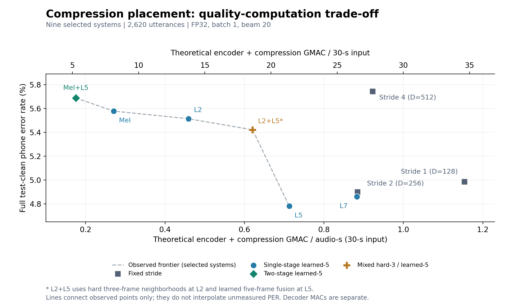

# 论文核心性能—计算量曲线（固定30秒）

2026-11-12按用户选择：移除128维stride4；L2+L5进入核心位置比较。当前共九组已核验工作点。

| 原归档ID | 系统 | 主干维度 | PER (%) | GMAC／30秒 | GMAC／音频秒 |
| --- | --- | ---: | ---: | ---: | ---: |
| S1 | Stride 1 | 128 | 4.9856 | 34.612238 | 1.153741 |
| S2 | Stride 2 | 256 | 4.8989 | 26.539015 | 0.884634 |
| E09 | Stride 4 | 512 | 5.7427 | 27.679450 | 0.922648 |
| E05 | Mel | 128 | 5.5782 | 8.114835 | 0.270494 |
| E02 | L2 | 128 | 5.5141 | 13.774741 | 0.459158 |
| E06 | L5 | 128 | 4.7809 | 21.380416 | 0.712681 |
| E07 | L7 | 128 | 4.8603 | 26.499048 | 0.883302 |
| E10 | Mel+L5 | 128 | 5.6882 | 5.267984 | 0.175599 |
| E08 | L2+L5* | 128 | 5.4210 | 18.615317 | 0.620511 |

当前入选集合的观察前沿：**Mel+L5 → Mel → L2 → L2+L5* → L5**。L2+L5补充了L2与L5之间的质量—计算量工作点；L7作为晚层位置对照继续显示。

*L2+L5*的第一阶段为hard三帧邻域，第二阶段为learned五帧融合。它是核心结构／插入位置对比，但融合规则与其他learned五帧系统不完全相同，不能将差异全部归因于位置。

所有点均为独立训练并按dev-clean选择checkpoint的模型。连线只标记入选系统的观察前沿，不代表同一checkpoint可连续调节，不插值未知PER。未计算新配对区间，不宣称点间差异有统计显著性。

横轴为校准保留率下的固定30秒编码器＋压缩主要MAC；纵轴为原始完整test-clean corpus PER，CPU/FP32/batch1/beam20。MAC计入投影、线性、卷积、注意力矩阵乘积、检测点积及融合；不计特征提取、归一化、激活、softmax、比较排序及访存。实际beam搜索predictor/joiner成本保留在历史全量计数中，不混入这条理论曲线。

该图是用户筛选的探索性工作点比较，不是全部stride扫描或全部实验的前沿。不同模型的宽度、batch和更新次数差异仍需披露。后续预算比较应先在dev-clean冻结预算和候选，再在独立集确认。

[入选与排除清单](../fixed_duration_selection.json) · [机器可读数据与来源哈希](points.json) · [CSV](points.csv) · [矢量PDF](quality_compute_30s.pdf) · [固定长度公式与范围](../../../docs/phone69_fixed_duration_macs.md)
