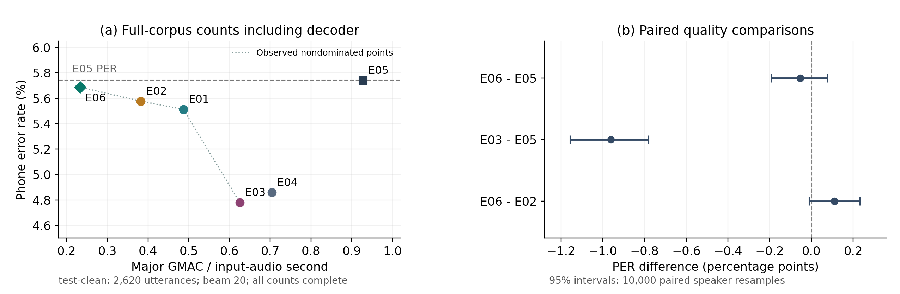

# ExtremaFuse 的 460h 实验结果与论文写作提纲

当前论文仅保留六组结果，重新连续编号 E01–E06。原 E01、E03、E04、E08 不进入正文、附录和结果图，原 E11 继续仅供内部参考。原始实验、配置、checkpoint 和评测文件仍用归档编号；[新旧编号对照](extremafuse_acl2027/README.md#当前论文实验与编号)和快照中的 `archive_id` 用于追溯。

双阶段 E06 的 test-clean PER 为 5.6882%，Stride4 主基线 E05 为 5.7427%。全量主要 MAC 分别为 0.23252 和 0.92697 GMAC／输入音频秒，降低 74.92%。PER 差值的配对区间跨零，因此当前支持计算量明显减少、观察到的 PER 接近；独立测试上的质量门槛待确认。

## 论文范围内的六个配置

所有模型用 train-clean-100 与 train-clean-360 共 460h 训练，评测同一批 test-clean 的 2,620 句、189,023 个参考音素与 19,452.480625 秒音频。离线、FP32、batch 1、beam 20。下表为完整语料主要 MAC，包含编码器及压缩与实际搜索中的 predictor、joiner。计数范围和来源哈希见[快照](extremafuse_acl2027/compute_snapshot.json)与[计数方案](phone69_460h_compute_eval_plan_20261108.md)。

| 论文编号 | 配置名称 | 投影 → 主干 | PER | 总 GMAC／音频秒 | 相对 E05 |
| --- | --- | --- | ---: | ---: | ---: |
| E01 | ExtremaFuse-L2 | 128 → 128 | 5.5141% | 0.48637 | 52.47% |
| E02 | ExtremaFuse-Mel | 128 → 128 | 5.5782% | 0.38207 | 41.22% |
| E03 | ExtremaFuse-L5 | 128 → 128 | 4.7809% | 0.62512 | 67.44% |
| E04 | ExtremaFuse-L7 | 128 → 128 | 4.8603% | 0.70362 | 75.91% |
| E05 | Stride4 主基线 | 128 → 512 | 5.7427% | 0.92697 | 100.00% |
| E06 | ExtremaFuse-Mel-L5 | 128 → 128 | 5.6882% | 0.23252 | 25.08% |

每帧投影均为 128 维。E05 四帧拼接后主干为 512，其他系统 stride 1、主干 128。系统比较须同时列明容量、压缩与训练配方，不将全部差异单独归因于峰谷选点。

左图用真实坐标展示六个工作点，虚线标记 E05 的 PER。按点估计，E06→E02→E01→E03 为当前候选的非支配前沿。连接线仅辅助阅读，不表示点间性能已经测量。右图为前者减后者的 PER 差值及说话人配对 95% 区间；40 位说话人联合重抽样 10,000 次，seed 42。区间仅反映固定 checkpoint 的测试抽样波动。

## 三个核心比较

| 比较 | 研究问题 | ΔPER，百分点 [95% 区间] | 合计计算量 |
| --- | --- | ---: | --- |
| E06 − E05 | 输入投影匹配的双阶段系统比较 | −0.054 [−0.192, +0.076] | 0.23252 对 0.92697，降低 74.92% |
| E03 − E05 | 预算内高精度工作点 | −0.962 [−1.157, −0.781] | 0.62512，为基线的 67.44% |
| E06 − E02 | 双阶段相对 Mel 单阶段的代价 | +0.110 [−0.011, +0.232] | 0.23252 对 0.38207，降低 39.14% |

E02 是直接的 Mel 前端替换，在观察到的更低 PER 下使用基线 41.22% 的主要 MAC。E01 与 E03 比较早层融合：编码器计算量由 0.43193 降至 0.29744，降低 31.14%；计入解码端后由 0.62512 降至 0.48637，降低 22.20%，PER 从 4.7809% 变为 5.5141%。E04（L7）相对 E03（L5）增加计算量，观察到的 PER 也略高，保留展示这一结果。

## 怎样控制计算量—性能曲线

先报告六个离散系统与观察前沿。要形成固定 stride 家族的预算曲线，建议补约三个较浅的 stride4 模型，保持每帧投影 128、四帧拼接、层内结构、predictor 和 joiner，先在 dev-clean 校准层数与实际总 MAC，使其覆盖约 0.40、0.50、0.65 GMAC／音频秒附近的预算。新模型独立训练；按预算在 dev 选点，冻结后报告测试实际质量和成本。主线不新增目标压缩率机制，不将 beam 扫描代替降采样曲线。[完整设计与控制条件](extremafuse_acl2027/compute_quality_curve_plan.md)

## 怎样解释第二次压缩

E02 和 E06 在 test-clean 的 Mel 阶段均输出 764,950 步；E06 第 5 层缩至 307,404 步，再减少 59.81%，最终保留原始 Mel 帧的 15.79%。PER 增加 0.110 个百分点，净增 208 个错误。两者分别训练，披露 E06 的调批和续训历史。[配对统计与帧数](../artifacts/research/phone69_460h_summary_20261107/mel_layer5_interpretability_20261107.json)

机制诊断从十个自然语速档各取 10 句，共 100 句、37 位说话人。E06 第 5 层输出该阶段输入的 40.19%；98.24% 的输入位置落在至少一个五帧窗口内，97.03% 在某个输出中获得至少 5% 权重。每个输出的平均有效输入数为 3.89，按权重平方和的倒数计算。[真实权重示例](../artifacts/research/phone69_460h_summary_20261107/mel_layer5_fusion_example_20261107.png)

冻结同一 E06 checkpoint、保留每句输出长度，只将第 5 层模块临时替换为均匀分段平均池化，每个参考音素的负对数似然增加 0.00117 nats，配对区间 [−0.00241, +0.00499]。这是模型对局部汇总的敏感性诊断；完整自适应系统与普通池化的 PER、计算量比较仍需原计划的独立池化训练。

## 语速和错误分析

语速为参考音素数除以包含停顿的整句时长。现有十档中第 1–3、4–7、8–10 档分别为慢、中、快三组，PER 按各组总错误数／总参考数计算。

| 自然语速 | 句数 | E05 PER | E06 PER | E06−E05，百分点 |
| --- | ---: | ---: | ---: | ---: |
| 慢 | 786 | 5.914% | 5.950% | +0.035 |
| 中 | 1,048 | 5.347% | 5.405% | +0.058 |
| 快 | 786 | 6.128% | 5.891% | −0.237 |

E06 全语料少 832 个删除、多 235 个替换和 494 个插入；快速组少 504 个删除、多 85 个替换和 255 个插入。快组减慢组的 PER 收益差为 −0.273 个百分点，95% 区间 [−0.697, +0.154]，仍跨零。在 dev-clean 冻结分界后于独立集确认。[归档语速配对分析（原编号）](../artifacts/research/phone69_460h_summary_20261107/acl_input128_baseline_pilot.json)

## 写作与待补证据

先给通用帧序列接口、自然峰谷选点与五帧学习融合，再说明 Conformer–RNN-T 验证系统。主结果先写 E06 对 E05 的计算量与质量，再写 E03 的高精度工作点；用 E02→E06 解释第二阶段的代价。E01、E04 补全单阶段位置，不将最优深度作为核心贡献。

六组全量 MAC 已完成并核验。接下来保留同位置、同主干、dev 校准帧预算的均匀池化独立训练和独立 test-other 评测；计算预算曲线的额外训练为本次新建议，尚未启动。报告历史训练差异、单 seed、英语 Phone69、单一离线骨干及主要 MAC 未覆盖的算子。[实验总计划](phone69_acl_2027_plan_20261107.md)
