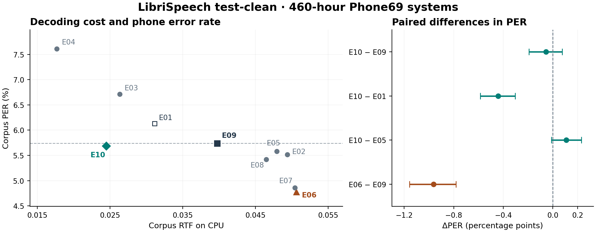

# ExtremaFuse 的 460h 实验结果与论文写作提纲

ExtremaFuse 按语音内容选择局部融合中心，用较短的帧序列表示整段语音。当前最适合写进摘要的观察来自两阶段配置 E10。相对每帧输入投影同为 128 维的固定步长系统 E09，其 CPU 模型解码耗时低 38.32%，test-clean 音素错误率分别为 5.6882% 和 5.7427%。第 5 层单阶段 E06 提供另一个工作点，识别错误更少，解码耗时也更高。[权威测试结果](phone69_460h_cpu_authoritative_20261108/summary.csv)

## 论文范围内的十个配置

所有模型用 train-clean-100 与 train-clean-360 训练，在相同的 test-clean 2,620 句、189,023 个参考音素上评测。使用离线 Conformer–RNN-T、CPU 4 个计算线程、FP32、batch 1、beam 20。PER 为语料级音素错误率。RTF 为总模型解码墙钟时间除以真实 FLAC 音频总时长，越小越快。表中的时间比为 RTF／E09 RTF。参数“投影 → 主干”指每帧输入投影维度与编码器主干宽度。[评测协议与来源](phone69_460h_cpu_authoritative_20261108/README.md)

| ID | 配置 | 投影 → 主干 | PER | 语料级 RTF | 时间比 |
| --- | --- | --- | ---: | ---: | ---: |
| E01 | 固定 stride 4 | 32 → 128 | 6.1289% | 0.03116 | 0.785 |
| E02 | stride 1，第 2 层五帧融合 | 128 → 128 | 5.5141% | 0.04938 | 1.243 |
| E03 | stride 2，第 2 层五帧融合 | 64 → 128 | 6.7135% | 0.02633 | 0.663 |
| E04 | stride 4，第 2 层五帧融合 | 32 → 128 | 7.6081% | 0.01771 | 0.446 |
| E05 | stride 1，Mel 融合 | 128 → 128 | 5.5782% | 0.04795 | 1.207 |
| E06 | stride 1，第 5 层融合 | 128 → 128 | 4.7809% | 0.05062 | 1.275 |
| E07 | stride 1，第 7 层融合 | 128 → 128 | 4.8603% | 0.05042 | 1.270 |
| E08 | stride 1，第 2 层保留中心及左右一帧，第 5 层融合 | 128 → 128 | 5.4210% | 0.04649 | 1.171 |
| E09 | 固定 stride 4，输入投影 128 | 128 → 512 | 5.7427% | 0.03971 | 1.000 |
| E10 | stride 1，Mel 与第 5 层融合 | 128 → 128 | 5.6882% | 0.02450 | 0.617 |

主表突出 E09、E10、E01 和 E06，训练完成后加入均匀池化。E05 进入机制分析。E02–E04 展示固定 stride 与早层动态压缩组合下的实测取舍。E07、E08 放在更详细的配置比较中。E08 的第一个阶段保留峰谷中心及其左右各一帧的并集，第二个阶段才使用五帧可学习融合。[配置和训练记录](../docs/phone69_460h_results.md)

左图中，靠左表示解码用时更少，靠下表示音素错误更少。虚线为 E09 的 PER。右图用点表示前者减后者的 PER 差值，横线为配对说话人抽样的 95% 百分位区间。对同一组 40 位说话人有放回联合抽样 10,000 次，以每次的总错误数除以总参考数，随机种子为 42。区间反映固定 checkpoint 的说话人抽样波动。每组 RTF 来自一次完整计时。

## 四个比较分别回答什么

| 比较 | 研究问题 | ΔPER，百分点 [95% 区间] | 解码耗时变化 |
| --- | --- | ---: | ---: |
| E10 − E09 | 输入投影匹配的主比较 | −0.054 [−0.192, +0.076] | −38.32% |
| E10 − E01 | 主干宽度与参数规模接近的补充比较 | −0.441 [−0.586, −0.303] | −21.38% |
| E06 − E09 | 高精度配置的时间成本 | −0.962 [−1.157, −0.781] | +27.47% |
| E10 − E05 | 双阶段相对 Mel 单阶段的代价 | +0.110 [−0.011, +0.232] | −48.91% |

- **E10 对 E09。** E10 净少 103 个音素错误，每单位音频使用基线 61.68% 的解码时间，约为 1.62 倍速度。探索性 PER 差值区间跨过零，适合写“观察到接近的识别质量和较低的解码成本”。E09 四帧拼接后主干为 512 维、约 2,958 万参数，E10 主干为 128 维、约 425 万参数。系统级效率差异包括容量与压缩结构的共同影响。
- **E10 对 E01。** 两个主干都是 128 维，参数分别为 425 万和 421 万。E10 净少 833 个错误，耗时也少 21.38%。这个对照说明，接近的参数规模下也观察到了收益。两者前端投影、stride 与训练预算仍有差异。
- **E06 对 E09。** E06 在测试集上少 1,818 个错误，同时耗时多 27.47%。它说明保留更多时间分辨率可以取得的识别质量，是主文中的高精度工作点。E06 和 E07 的 RTF 相差约 0.40%，PER 差值为 −0.079 个百分点，区间 [−0.179, +0.016]，层位排名宜作为附录观察。
- **E10 对 E05。** 两者在 Mel 阶段均输出 764,950 步，E10 在第 5 层缩至 307,404 步，进一步减少 59.81%，最终保留原始 Mel 的 15.79%。本轮解码耗时少 48.91%，PER 高 0.110 个百分点，净增 208 个错误。E05 和 E10 分别训练，E10 还有历史调批和续训，差值描述两个已训练系统。[配对统计、帧数和核验记录](../artifacts/research/phone69_460h_summary_20261107/mel_layer5_interpretability_20261107.json)

## 怎样解释识别质量

从十个自然语速档各抽 10 句，共 100 句、37 位说话人。E10 在第 5 层输出该阶段输入时间步的 40.19%，98.24% 的输入位置落在至少一个五帧窗口内，97.03% 的输入位置在某个输出中获得至少 5% 权重。每个输出平均有效使用 3.89 帧，有效数按权重平方和的倒数计算。图中可呈现一小段语音的真实选点与融合权重，说明较短的输出序列怎样汇集周围帧的特征。[真实融合示例](../artifacts/research/phone69_460h_summary_20261107/mel_layer5_fusion_example_20261107.png)

在同一批 100 句、同一 E10 checkpoint 中，保持每句输出长度，临时把第 5 层的整个压缩模块换成均匀分段平均池化。每个参考音素的负对数似然只增加 0.00117 nats，配对区间 [−0.00241, +0.00499]。这一观察与上下文表示能容忍不同的局部汇总方式相容。自适应方法相对普通池化的优势由独立训练的池化对照检验。[同长度替换结果](../artifacts/research/phone69_460h_summary_20261107/mel_layer5_interpretability_20261107.json)

## 语速和错误分析

语速为参考音素数除以整句时长，包含停顿。使用已有十档中的第 1–3、4–7、8–10 档作为慢、中、快三组，按各组自己的参考数和音频时长聚合 PER 与 RTF。

| 自然语速 | 句数 | E09 PER | E10 PER | E10−E09，百分点 | E10 解码耗时变化 |
| --- | ---: | ---: | ---: | ---: | ---: |
| 慢 | 786 | 5.914% | 5.950% | +0.035 | −42.55% |
| 中 | 1,048 | 5.347% | 5.405% | +0.058 | −37.45% |
| 快 | 786 | 6.128% | 5.891% | −0.237 | −36.17% |

相对 E09，E10 在慢速组多 13 个错误，中速组多 48 个错误，快速组少 164 个错误，语料合计少 103 个。全体语句中，E10 少 832 个删除，多 235 个替换和 494 个插入。快速组少 504 个删除，多 85 个替换和 255 个插入。快速组的 PER 差值是 −0.237 个百分点，配对区间 [−0.447, −0.010]。直接比较快慢组的收益差异为 −0.273 个百分点，区间 [−0.697, +0.154]，跨过零。把快语速漏识的改善作为探索性结果，同时报告多出的插入。在 dev-clean 冻结语速边界，再于独立测试集确认。[语速配对分析](../artifacts/research/phone69_460h_summary_20261107/acl_input128_baseline_pilot.json)

## 从研究问题写到结论

1. **引言提出时间分辨率问题。** 固定步长在规则时间间隔上处理语音，音素辨别所需的声学变化发生在不同位置。提出能否用较少的表示覆盖这些局部变化，并检验真实解码成本。
2. **方法只讲一个完整模块。** 输入是有序帧向量，输出是维度相同、长度自适应的帧序列。在相邻帧余弦距离的局部峰谷选中心，由五帧内容预测融合权重。说明如何放在前端或时序编码层之间，再介绍 Conformer–RNN-T 和 Phone69 验证任务。
3. **主结果先写 E10 对 E09，再以 E01 检查容量因素。** 报原始 PER、语料级 RTF、耗时变化、参数与训练更新数。E06 展示准确率与成本的另一种取舍。图中给实测离散点，保持各配置的真实时间差距。
4. **机制先解释少了多少步，再解释保留了什么。** 用 E05→E10 的实际帧数与耗时说明二次压缩的代价，再用真实权重和同长度替换研究局部汇总。最后用语速、删除与插入说明收益出现在哪些语句上。
5. **讨论限定到实测系统。** 方法接口适用于可变长帧表示。当前效率与 PER 证据来自 460h 英语 Phone69、一个训练 seed 和一种离线骨干。训练步数及容量差异随配置披露。

**摘要结果段英文草案**

> On LibriSpeech test-clean, a two-stage ExtremaFuse system achieved a phone error rate of 5.69% and a CPU decoding real-time factor of 0.02450, compared with 5.74% and 0.03971 for a fixed-stride baseline with the same per-frame input projection width. Adding a second fusion stage reduced the number of encoder output steps by 59.8% relative to Mel-only fusion, with a 0.11 percentage-point increase in phone error rate.

## 投稿前需要补足的证据

1. 新增一次均匀池化训练，使两处位置、主干和在 dev-clean 校准的帧预算与 E10 对应。复用已有 E09、E10、E06 checkpoint，报告训练预算差异。
2. 在确认未用于选模、音频与 Phone69 标签完整匹配的 test-other 上评测冻结系统。事先约定允许的 PER 损失，再检验“达到基线质量门槛”。
3. 对关键模型在同设备、同协议下重复整集计时，平衡各轮先后顺序，报告 E10／E09 比值的波动。若要主张“同速更准”，先在开发集定义等速带并冻结可比运行点，再在独立数据验证 PER 优势。[完整验证方案](phone69_acl_2027_plan_20261107.md)
